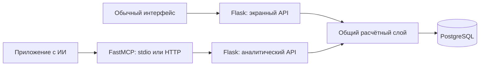

# Аналитический API и MCP

Связь с фронтендом, локальная Qwen и пользовательский сценарий описаны в [assistant.md](assistant.md).

Реализация плана доработки бэкенда от 17 ноября 2026 года. ИИ-модель работает в отдельном MCP-клиенте: сервер предоставляет данные и выполняет проверяемую числовую часть анализа. Генерация текста, сохранение отчётов и экспорт в Word остаются задачами клиента.



## Этапы плана

| № | Результат | Реализация |
|---|---|---|
| 1 | Получение данных без браузерной сессии | `services/filter_service.py`, `analytics/filters.py`; старое хранение фильтров удалено |
| 2 | Числовой формат, единицы, `null` | `analytics/balance.py`, `contracts.py`; форматирование экрана вынесено в `legacy.py` |
| 3 | Явные периоды и фильтры | `Period`, `QuerySpec`; диапазон 1–12 месяцев одного года, без ограничения тремя месяцами |
| 4 | Каталог наборов и показателей | `GET /analytics/catalog`, `analytics/catalog.py` |
| 5 | Сводка, детализация, сопоставление | `/balance-summary`, `/balance-details`, `/compare-periods`; доли и изменения считает бэкенд |
| 6 | MCP | `mcp_server/server.py`: пять инструментов, stdio и Streamable HTTP |
| 7 | Только чтение и проверка прав | Bearer-ключи с `balance:read`, область продуктов/базисов, read-only транзакции PostgreSQL |
| 8 | Проверяемость | UUID запроса, применённые фильтры, версия расчёта, SHA-256 снимка, отдельные ошибки |
| 9 | Журналирование и условия эксперимента | JSON-аудит Flask/MCP, фиксированный дамп, контрольные примеры и шаблон измерений |
| 10 | Контрольные проверки | Тесты бэкенда, MCP и `experiments/run_controls.py`: сопоставление UI/API/MCP |

## Установка и запуск

Flask сохраняет существующие зависимости и совместимость с Python 3.8. FastMCP 4.2.0 запускается отдельно на Python 3.11+; Docker-образ использует Python 3.12. Полные зависимости MCP зафиксированы в `mcp_server/requirements.lock.txt`.

Создать локальную конфигурацию с новым случайным ключом:

```sh
python3 scripts/configure_analytics.py
```

Скрипт создаёт `.env.analytics` с правами `0600`, не печатает ключ и не перезаписывает существующий файл. Файл исключён из Git. Для ручной настройки есть `config/analytics.env.example`.

Запустить бэкенд и MCP рядом с существующим приложением:

```sh
docker compose --env-file .env.analytics \
  -f docker-compose.dev.yaml -f docker-compose.mcp.yaml \
  up --build -d bcp_backend balance_mcp
```

Это запускает также зависимую PostgreSQL. База должна быть наполнена обычным способом проекта. **`make update-db` пересоздаёт локальную БД**, поэтому контрольные фикстуры следует загружать в отдельную экспериментальную базу.

HTTP MCP доступен на `http://127.0.0.1:8001/mcp`. Порт опубликован только на localhost. Сервис аналитики использует `/analytics` под обычным адресом Flask.

Для локального MCP-процесса:

```sh
python3.12 -m venv .venv-mcp
.venv-mcp/bin/pip install -r mcp_server/requirements.lock.txt
set -a
. ./.env.analytics
set +a
.venv-mcp/bin/python -m mcp_server.server --transport stdio
```

STDIO использует stdout только для MCP; журналы идут в stderr. Ключ stdio-процесса проверяется Flask на каждом обращении.

Примеры подключения клиента находятся в `config/mcp.stdio.example.json` и `config/mcp.http.example.json`. Замените абсолютные пути и ключ. Это примеры формата `mcpServers`; конкретный клиент может использовать другой формат настроек.

## Права

`BALANCE_ANALYTICS_TOKENS` содержит JSON-реестр ключей. Пример с двумя субъектами:

```json
{
  "reader-key": {"subject":"analyst","scopes":["balance:read"]},
  "limited-key": {"subject":"limited-analyst","scopes":["balance:read"],"product_ids":[1],"basis_ids":[1]}
}
```

Имена ключей в примере нужно заменить случайными значениями. Отсутствующий список ID означает доступ ко всем соответствующим сущностям; пустой список запрещает все. Неявный выбор ограничивается разрешёнными ID. Явный запрос запрещённого продукта или базиса даёт 403. Настройки читаются бэкендом; изменение окружения требует перезапуска процесса.

Без реестра новый аналитический интерфейс закрыт с ошибкой `auth_not_configured`. Обычные экранные API не требуют нового ключа; браузерный access control не возвращён.

При HTTP MCP проверяет ключ через `/analytics/access` и передаёт именно ключ вызывающего пользователя в аналитический API. Подстановка привилегированного сервисного ключа при отсутствии пользовательского запрещена. В stdio ключ задаётся через окружение запускаемого процесса. Ни один инструмент не принимает SQL, URL сервиса, имя таблицы или метод записи.

Bearer-проверка рассчитана на локальную/контролируемую среду. OAuth/SSO и публичное развёртывание не входят в эту реализацию; для внешнего подключения следует отдельно настроить доверенную авторизацию и TLS.

## HTTP-контракт

Все операции аналитики — `GET` с `Authorization: Bearer <token>`:

| Адрес | Назначение |
|---|---|
| `/analytics/catalog` | Наборы, показатели, формулы, единицы и правила |
| `/analytics/filter-values` | Разрешённые продукты, категории, базисы, единицы и доступные периоды |
| `/analytics/balance-summary` | Сводка с отдельной группой для каждой единицы измерения |
| `/analytics/balance-details` | Детализация по `product`, `basis`, `month` |
| `/analytics/compare-periods` | Сравнение двух периодов с общими фильтрами |
| `/analytics/access` | Проверка субъекта и прав; используется HTTP-аутентификацией MCP |

Для сводки и детализации обязательны `year`, `month_start`. `month_end` по умолчанию равен `month_start`; обе границы включаются. Год 1–9999, месяц 1–12. Переход между годами одним диапазоном не поддерживается; для сравнения можно задать два разных года. Неизвестные и повторяющиеся параметры отклоняются.

`products`, `categories`, `basises`, `metrics`, `group_by` передаются списками через запятую. Названия берутся из `filter-values`, метрики — из каталога. Выбор продуктов и категорий должен быть согласован. Отсутствующий фильтр означает все разрешённые значения, а не сохранённый выбор браузера. Имена с запятыми не поддерживаются этим CSV-форматом; это явное ограничение первой версии.

Пример запроса:

```sh
curl --get http://127.0.0.1:5001/analytics/balance-summary \
  -H "Authorization: Bearer $BALANCE_ANALYTICS_TOKEN" \
  --data-urlencode year=2025 --data-urlencode month_start=11 \
  --data-urlencode 'categories=Бензин АИ-92'
```

Успешный ответ:

```json
{
  "status":"ok",
  "metadata":{
    "query_id":"uuid",
    "actor":"analyst",
    "period":{"year":2025,"month_start":11,"month_end":11},
    "requested_filters":{},
    "applied_filters":{},
    "data_version":{"schema":"balance-analytics-v1","calculation_version":"balance-core-1","snapshot_id":"sha256:...","source_counts":{}},
    "warnings":[],
    "result_count":1
  },
  "data":{"groups":[{"unit":{"id":2,"name":"тыс. т"},"dimensions":{},"metrics":{"allocated_volume":657},"exact_metrics":{"allocated_volume":"657.0"},"null_reasons":{}}]}
}
```

`metrics` содержит JSON-числа без округления для экрана. `exact_metrics` сохраняет десятичное представление для проверки точности транспорта. Вычисления выполняются `Decimal` с точностью 50 значащих цифр; периодические дроби в долях имеют эту вычислительную точность. `null` отличается от нуля. Неизвестное слагаемое делает суммарный показатель неизвестным; пропущенное значение не отбрасывается из суммы.

Доступный ресурс берётся из материализованного расчёта `tab_resource_bk`. Действующая функция `repositories/utils.py:calc_resource` вычисляет `base = план + остаток − минимальный запас` для плановой записи и выбирает `base`, если лимит отгрузки равен нулю либо `base < лимита` и `base != 0`; иначе выбирает лимит. Каталог описывает эту формулу без пересчёта сохранённых результатов. Если расчёта нет, ресурс возвращается как `null` с предупреждением. Заявки и распределённые объёмы берутся из `tab_dataset_bk`; пустые технические строки без ID заявки в количество и объёмы заявок не входят.

**Временная агрегация:** за диапазон выводятся суммы месячных показателей, в том числе месячных входящих остатков и доступного ресурса, как в экранной таблице. Сумму месячных остатков нельзя интерпретировать как единственный начальный запас периода. Все объёмы группируются по точной единице измерения: тонны, тысячи тонн и тысячи кубометров автоматически не смешиваются. Проценты вычисляются из итоговых объёмов, а не усредняются по строкам.

`balance-details` принимает `group_by=product,basis,month`, `limit` 1–10000 (по умолчанию 500), `offset` 0–1000000. `metadata.pagination` содержит `total_count`, `has_more`, `limit`, `offset`; для полного результата нужно получить все страницы. Период не сокращается.

`compare-periods` принимает `baseline_year`, `baseline_month_start`, необязательный `baseline_month_end` и аналогичные `comparison_*`. Изменение — comparison − baseline; относительное изменение — изменение / baseline × 100. При нулевой базе процент равен `null`, причина `zero_baseline`; при отсутствии данных — `missing_value`. Для процентных метрик абсолютное изменение выражено в процентных пунктах.

`snapshot_id` можно передать обратно в сводку, детализацию или сравнение. Изменение исходных строк/справочников/выбранного периода приводит к 409. Это отпечаток прочитанных данных, а не архив старых версий: для повторения старого результата нужен сохранённый дамп. PostgreSQL читается в `REPEATABLE READ READ ONLY`; оба периода сравнения используют одну транзакцию.

Экранные `/sankey/table`, `/waterfall`, `/stock_details`, `/graph` и прямые методы `ShipmentsService` используют тот же калькулятор. Экранная таблица форматирует значения отдельно и больше не добавляет следующий месяц к явно выбранному периоду. Ответы экрана содержат заголовки `X-Query-ID` и `X-Data-Snapshot` для сопоставления с аналитикой. Устаревший `transport_details` возвращает явную ошибку 410.

## MCP-инструменты

| Инструмент | Вход | Результат |
|---|---|---|
| `get_data_catalog` | Без параметров | Каталог наборов/метрик и правил |
| `get_filter_values` | Необязательные `period`, продукты, категории, базисы | Доступные значения в области прав |
| `get_balance_summary` | `period`, фильтры, необязательные `metrics`, `snapshot_id` | Числовая сводка по единицам |
| `get_balance_details` | То же + `group_by`, `limit`, `offset` | Строки детализации и явная пагинация |
| `compare_periods` | `baseline`, `comparison`, общие фильтры и метрики | Значения, разницы и проценты |

Период MCP — объект `{ "year":2025, "month_start":11, "month_end":12 }`. В MCP фильтры и группировки передаются массивами строк. Все инструменты имеют типизированную схему входа, описание результата и read-only аннотации. Ошибки API сохраняют код и ID запроса в ошибке инструмента; не превращаются в пустые данные.

## Ошибки и журналы

| HTTP | Коды |
|---|---|
| 400 | `invalid_period`, `unknown_filter`, `filter_conflict`, `unsupported_parameter`, `unsupported_grouping`, `unknown_metric`, `duplicate_parameter`, `incompatible_units` |
| 401 | `unauthorized` |
| 403 | `insufficient_scope`, `forbidden_filter` |
| 409 | `snapshot_changed` |
| 422 | Некорректные численные данные, единицы или повторные расчётные записи |
| 503 | `database_unavailable`, `auth_not_configured` |
| 500 | `calculation_error`, `internal_error` |

Пустая выборка — HTTP 200, `status: "empty"`, пустые группы. Известные нули — `status: "ok"`, числовые нули. Неизвестные поля — `null` и предупреждения/причины. SQL и строки подключения в ответ не включаются.

Flask пишет события JSON в `balance.analytics.audit`, MCP — в `balance.mcp.audit`, оба в stderr. События содержат операцию/инструмент, параметры, начало/окончание, длительность, статус, число записей и ID запроса. Flask дополнительно фиксирует субъекта и снимок. Заголовки авторизации не журналируются. События ошибок тоже сохраняются.

```sh
docker compose --env-file .env.analytics -f docker-compose.dev.yaml -f docker-compose.mcp.yaml \
  logs --no-log-prefix bcp_backend balance_mcp > experiment-server.log
```

## Контрольные примеры и эксперимент

Для контролей нужен **отдельный экземпляр БД**: восстановить `BK.sql`, затем `experiments/edge_cases.sql`. Последний добавляет только две исторические контрольные записи 2024 года: известные нули и отсутствующие значения. Оба условия исследования должны использовать один и тот же зафиксированный экземпляр/снимок данных.

В `experiments/control_cases.json` зафиксированы 13 заданий и SHA-256 исходного дампа. Среди независимых контрольных значений: ноябрь 2025, АИ-92 — ресурс 722, распределено 657, биржа 216 тыс. т; декабрь — распределено 734; изменение +77. Есть разделение единиц, пустая выборка, ошибки фильтров/месяцев, ноль, `null` и нулевая база сравнения.

```sh
# Из корня проекта, после настройки окружения:
PYTHONPATH=backend python3 -m unittest discover -s backend/tests -v
.venv-mcp/bin/python -m unittest mcp_server.test_server -v
.venv-mcp/bin/python -m experiments.run_controls --base-url http://127.0.0.1:5001
.venv-mcp/bin/python -m experiments.run_controls --base-url http://127.0.0.1:5001 \
  --mcp-url http://127.0.0.1:8001/mcp --output experiments/results/http-controls.json
```

Скрипт вызывает обычный экранный API, новый API и настоящий MCP-процесс/HTTP-сервер, сравнивает числа и снимки, проверяет контрольные значения. Результат содержит ID запросов, отпечатки данных и контрольных файлов. Генерируемые результаты исключены из Git.

`round_trip_ms` в контролях измеряет выполнение проверочных запросов; **это не время подготовки отчёта и не оценка ускорения работы аналитика**. Полное время задания фиксируется отдельно по `experiments/measurements.csv`: от предъявления запроса до проверенного отчёта, включая уточнения и исправления. Для ручного и агентного сценариев используются одинаковые запросы, фильтры, права и данные. Ограниченный ключ применяется для проверки безопасности, а не для сравнения с неограниченным ручным сценарием.

### Проверено при реализации

Сводный протокол: [validation.md](validation.md).

- Тесты бэкенда: независимость фильтров от Flask-сессии, полный год, значения/единицы, права, ошибки, снимки и сравнения.
- Тесты MCP: обнаружение ровно пяти read-only инструментов, схемы, фильтры, ошибки и запрет подстановки сервисного ключа.
- Все 13 контрольных примеров через настоящий stdio и через HTTP.
- HTTP: анонимный вызов отклоняется, ограниченный пользователь получает только свой продукт/базис.
- Существующая панель и журнал открываются в браузере без запросов старого access control.
- Отдельный образ MCP собирается на Python 3.12 с зафиксированными зависимостями.

## Основные источники

- [FastMCP Quickstart](https://gofastmcp.com/docs/getting-started/quickstart)
- [FastMCP Token Verification](https://gofastmcp.com/docs/servers/auth/token-verification)
- [MCP Architecture](https://modelcontextprotocol.io/docs/learn/architecture)
